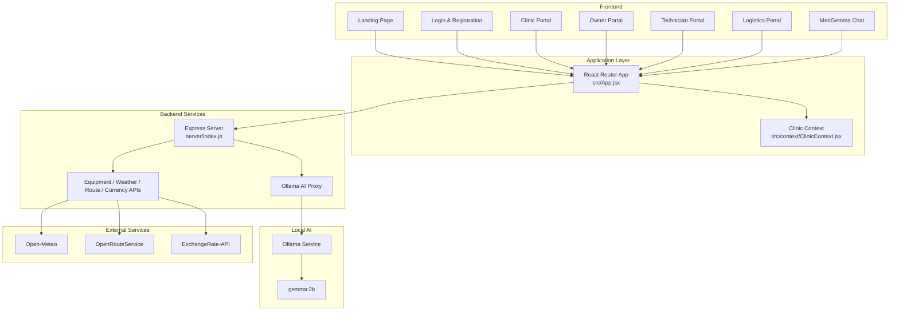

# ResourceRX

AI-powered peer-to-peer medical equipment sharing network for hospitals and healthcare facilities that need high-value equipment quickly and reliably.

ResourceRX connects facilities with idle MRI scanners, ventilators, dialysis units, CT machines, and other critical equipment to hospitals with urgent demand, all through role-specific portals for clinics, equipment owners, technicians, and logistics teams.

[](https://nodejs.org/)
[](https://react.dev/)
[](https://vite.dev/)
[](https://ollama.com/)

## What the project does

ResourceRX is a local-first medical equipment marketplace and operations platform. It allows a hospital to locate available devices, request equipment, track delivery status, review analytics, and coordinate technicians and logistics without depending on a hosted SaaS platform.

The application includes four primary user flows:

- Clinic portal for searching, booking, tracking, and paying for equipment
- Owner portal for listing equipment, tracking utilization, and managing settlements
- Technician portal for service orders, diagnostics, calibration, and inventory checks
- Logistics portal for active shipments, routing, weather-aware ETA, and issue handling

## Why the project is useful

ResourceRX solves a real operational problem in healthcare: high-value equipment is often underutilized in one facility while another facility is facing urgent demand.

Key benefits:

- Faster equipment access during shortages or emergencies
- Better utilization of expensive medical assets
- Transparent workflows for booking, dispatch, and servicing
- Real-time operational visibility for delivery and maintenance teams
- AI-assisted recommendations and troubleshooting using a local Ollama model
- Local deployment to preserve privacy and reduce cloud dependency

## Architecture overview



## Project structure

```text
ResourceRX/
├── src/
│   ├── pages/
│   │   ├── Clinic/             Clinic workflows and dashboards
│   │   ├── Logistics/          Logistics workflows and dashboards
│   │   ├── Owner/             Owner dashboards and asset management
│   │   ├── Technician/        Technician workflows and service management
│   │   ├── LandingPage.jsx     Product landing page
│   │   └── LoginPage.jsx       Authentication entry point
│   ├── components/
│   │   ├── ClinicSideBar.jsx
│   │   ├── LogisticsSideBar.jsx
│   │   ├── MedGemmaChat.jsx
│   │   ├── OwnerSideBar.jsx
│   │   └── TechnicianSideBar.jsx
│   ├── context/
│   │   └── ClinicContext.jsx
│   ├── App.jsx                Main route definitions
│   ├── App.css                Global app styles
│   ├── index.css              Tailwind/global styles
│   ├── main.jsx               App bootstrap
│   └── medgemma.js            Local AI proxy helper
├── server/
│   ├── index.js               Express API server
│   └── package.json
├── public/
├── index.html
├── package.json
├── vite.config.js
├── tailwind.config.js
├── postcss.config.cjs
├── eslint.config.js
├── README.md
├── .gitignore
└── pnpm-lock.yaml
```

## Technology stack

- Frontend: React 19 + Vite
- Styling: Tailwind CSS + custom CSS
- Routing: React Router DOM
- UI motion: Framer Motion
- AI: Local Ollama with the `gemma:2b` model
- Backend: Express.js
- External APIs: Open-Meteo, OpenRouteService, ExchangeRate-API

## Getting started

### Prerequisites

- Node.js 18 or newer
- npm
- Ollama installation
- Git

### 1. Install frontend dependencies

```bash
npm install
```

### 2. Install backend dependencies

```bash
cd server && npm install && cd ..
```

### 3. Install Ollama and pull the model

```bash
curl -fsSL https://ollama.com/install.sh | sh
ollama pull gemma:2b
```

If you are on Windows, install Ollama from the official site and then run the same `ollama pull gemma:2b` command in a terminal.

### 4. Run the app

Open three terminals.

Terminal 1: start the AI engine

```bash
ollama serve
```

Terminal 2: start the Express backend

```bash
cd server
node index.js
```

Terminal 3: start the frontend

```bash
npm run dev
```

Once running, open:

- Frontend: http://localhost:5173
- Backend: http://localhost:5000

### Verify the AI backend

```bash
curl http://localhost:5000/test-ai
```

You should receive a JSON response indicating the AI service is online.

## Main backend capabilities

The Express server in `server/index.js` exposes several local and external data endpoints:

- `GET /api/positions` — real-time equipment positions
- `GET /api/equipment` — inventory and equipment catalog data
- `GET /api/weather` — current weather based on coordinates
- `GET /api/route` — route/distance estimates between locations
- `GET /api/currency` — exchange rate data
- `POST /api/medgemma` — AI prompt proxy to the local Ollama model
- `GET /test-ai` — lightweight AI connectivity check

## How users can get help

For help, use the project’s GitHub support channels:

- Report bugs or request features in the repository issues tracker
- Ask questions in the discussion area if available
- Review the local app flows and source files in the repository for implementation details

## Maintainers and contributors

ResourceRX is maintained by the repository owner and project contributors on GitHub.

Contributions are welcome via pull requests. Please keep changes focused, document new behavior, and test locally before opening a PR.

## Contributing

1. Fork the repository.
2. Create a new branch for your feature or fix.
3. Make your changes and validate locally.
4. Open a pull request with a clear summary.

## License

This project does not currently expose a license file in the repository, so licensing details should be confirmed by the repository owner before broader reuse or redistribution.

## Support

If the project is being used in a real healthcare environment, validate all operational logic with local compliance, clinical safety, and procurement review processes before production deployment.
