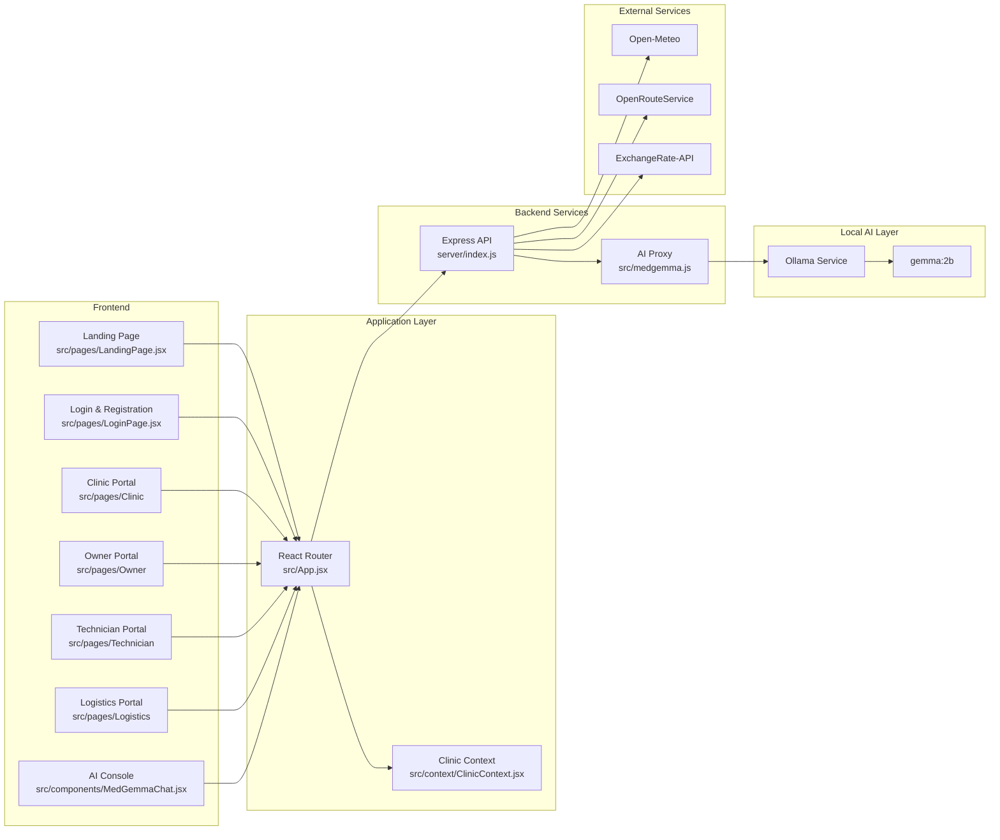
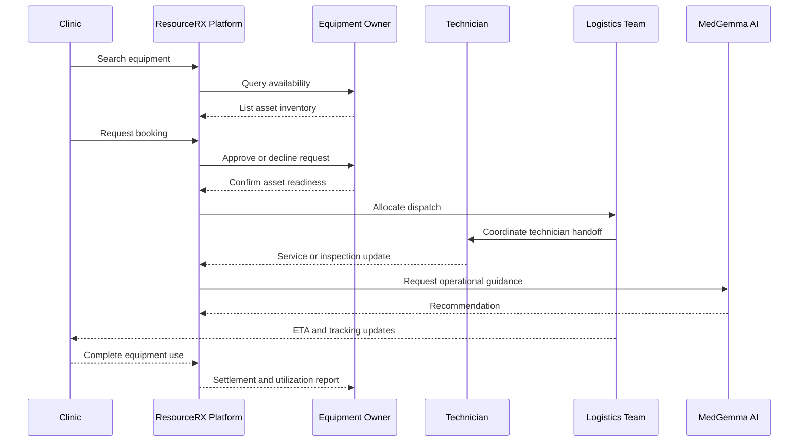
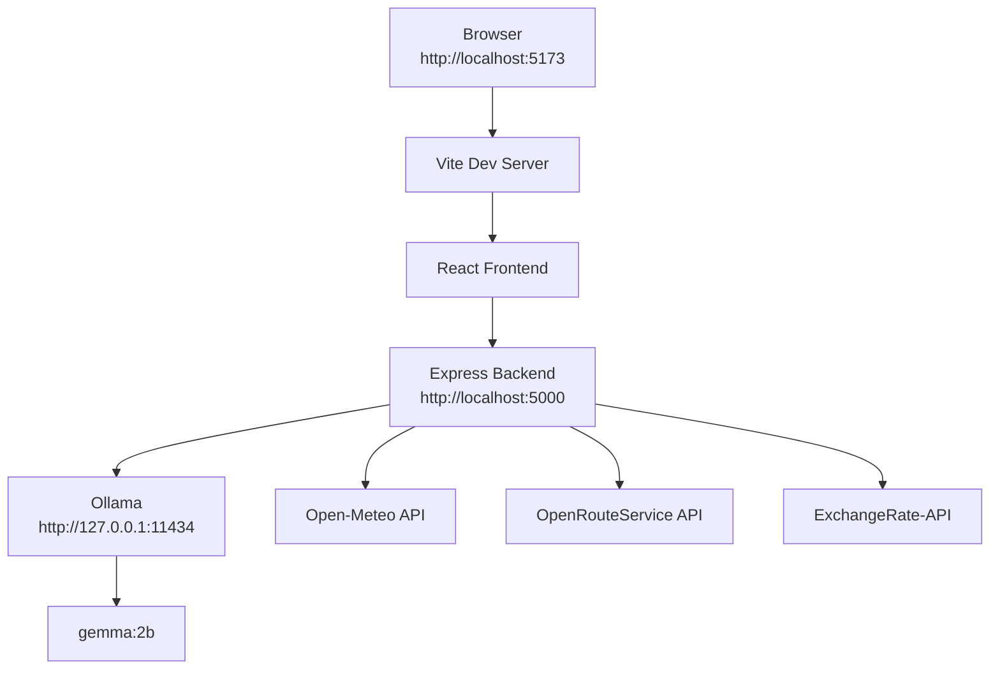

# ResourceRX

AI-powered peer-to-peer medical equipment sharing network for hospitals and care facilities facing urgent equipment shortages.

ResourceRX connects facilities with idle high-value medical assets — MRI scanners, ventilators, dialysis units, CT scanners, and other critical equipment — with organizations that need them quickly. The platform is organized around four role-specific portals: clinic, owner, technician, and logistics.

[](https://nodejs.org/)
[](https://react.dev/)
[](https://vite.dev/)
[](https://ollama.com/)
[](https://developer.mozilla.org/en-US/docs/Web/JavaScript)
[](LICENSE)

## What this project does

ResourceRX is a local-first healthcare asset-sharing platform built to reduce equipment bottlenecks and improve utilization of expensive medical technology.

The core workflow is simple:
- a clinic identifies equipment it needs
- an owner lists available devices
- logistics coordinates movement
- technicians prepare and validate equipment
- the system uses local AI to support operational decisions

This is designed as a real operational prototype for shortages, urgency response, and equipment lifecycle coordination.

## Why this is useful

The problem ResourceRX addresses is common in healthcare operations:
- equipment sits idle in one facility while another faces downtime
- urgent cases can’t wait for slow, fragmented manual coordination
- field teams often lack a single interface for managing movement, service, and status

### Benefits

- Faster access to critical equipment during shortages
- Better asset utilization for high-cost infrastructure
- Stronger operational visibility across booking, route, tracking, and service
- Role-specific experiences for different stakeholders
- AI-assisted guidance using a local model with no cloud dependency
- Privacy-friendly, local-first architecture

## Project overview



## Role-based portal architecture

```mermaid
flowchart TB
    subgraph Clinic[Clinic Portal]
        Search[Search Equipment]
        Booking[Requests & Booking]
        Track[Tracking]
        Pay[Payments]
        Feedback[Completion & Feedback]
    end

    subgraph Owner[Owner Portal]
        Add[Add Inventory]
        Analytics[Asset Analytics]
        Dispatch[Dispatch Coordination]
        Settle[Settlements]
    end

    subgraph Tech[Technician Portal]
        Service[Service Orders]
        Diagnose[Diagnostics]
        Calibrate[Calibration]
        Inventory[Inventory]
    end

    subgraph Logistics[Logistics Portal]
        Active[Active Shipments]
        Incidents[Incident Handling]
        Map[Map View]
        Logs[Operational Logs]
    end

    Search --> Booking --> Track --> Pay --> Feedback
    Add --> Analytics --> Dispatch --> Settle
    Service --> Diagnose --> Calibrate --> Inventory
    Active --> Incidents --> Map --> Logs

    click Search "https://github.com/Jasmine0987/ResourceRX/tree/main/src/pages/Clinic"
    click Add "https://github.com/Jasmine0987/ResourceRX/tree/main/src/pages/Owner"
    click Service "https://github.com/Jasmine0987/ResourceRX/tree/main/src/pages/Technician"
    click Active "https://github.com/Jasmine0987/ResourceRX/tree/main/src/pages/Logistics"
```



## Equipment lifecycle flow



## Runtime / deployment model



## Feature highlights

- Four role-based portals with dedicated user journeys
- Search and booking flow for urgent equipment requests
- Real-time position tracking and ETAs
- Medical equipment inventory with typed categories
- AI-guided operations using local Ollama inference
- Logistics and technician workflows for coordination
- Weather, route, and market-aware operational context

## Technology stack

### Frontend
- React 19
- Vite
- React Router DOM
- Tailwind CSS
- Framer Motion
- Lucide React

### Backend
- Node.js 18+
- Express 5
- Local API layer
- CORS support for frontend dev workflow

### AI and external data
- Ollama with `gemma:2b`
- Open-Meteo
- OpenRouteService
- ExchangeRate-API

## Project structure

```text
ResourceRX/
├── src/
│   ├── pages/
│   │   ├── Clinic/
│   │   ├── Logistics/
│   │   ├── Owner/
│   │   ├── Technician/
│   │   ├── LandingPage.jsx
│   │   └── LoginPage.jsx
│   ├── components/
│   │   ├── ClinicSideBar.jsx
│   │   ├── LogisticsSideBar.jsx
│   │   ├── MedGemmaChat.jsx
│   │   ├── OwnerSideBar.jsx
│   │   └── TechnicianSideBar.jsx
│   ├── context/
│   │   └── ClinicContext.jsx
│   ├── App.jsx
│   ├── App.css
│   ├── index.css
│   ├── main.jsx
│   └── medgemma.js
├── server/
│   ├── index.js
│   └── package.json
├── public/
├── index.html
├── package.json
├── vite.config.js
├── tailwind.config.js
├── postcss.config.cjs
├── eslint.config.js
├── README.md
├── .gitignore
├── pnpm-lock.yaml
└── LICENSE
```

## Getting started

### Prerequisites
- Node.js 18+
- npm
- Ollama installed locally
- Git

### 1. Install frontend dependencies

```bash
npm install
```

### 2. Install backend dependencies

```bash
cd server && npm install && cd ..
```

### 3. Install and pull the local AI model

```bash
curl -fsSL https://ollama.com/install.sh | sh
ollama pull gemma:2b
```

### 4. Run the application

Open three terminals.

#### Terminal 1: start Ollama

```bash
ollama serve
```

#### Terminal 2: start the backend

```bash
cd server
node index.js
```

#### Terminal 3: start the frontend

```bash
npm run dev
```

Once started:
- Frontend: http://localhost:5173
- Backend: http://localhost:5000

### Verify AI backend

```bash
curl http://localhost:5000/test-ai
```

The response should confirm the local AI service is online.

## Main API routes

The backend in `server/index.js` exposes a set of local and live-data endpoints:

| Method | Route | Purpose |
|---|---|---|
| GET | `/` | Backend health check |
| GET | `/api/positions` | Real-time equipment locations |
| GET | `/api/equipment` | Equipment catalog and inventory |
| GET | `/api/weather` | Weather-based ETA analysis |
| GET | `/api/route` | Distance and route estimation |
| GET | `/api/currency` | Exchange rate data |
| POST | `/api/medgemma` | Send prompt to local Ollama instance |
| GET | `/test-ai` | AI service connectivity check |

## Developer notes

This project is built to run locally with lightweight fallback data when external services are unavailable. It intentionally balances realism and demoability:
- the backend maintains in-memory equipment positions
- weather and route data are pulled from public APIs where available
- currency exchange rates are available via APIs or fallback values
- AI calls run locally using Ollama instead of a hosted model

This makes it easy to run, test, and demo without a production cloud stack.

## How users can get help

- Open a GitHub issue for bugs or feature requests
- Use discussions if enabled in the repository
- Review the code in `src/`, `src/pages/`, and `server/index.js`
- Validate behavior with the local app and backend endpoints

## Who maintains and contributes

This project welcomes contributors through GitHub pull requests. The repository owner and contributors manage the project in the GitHub ecosystem.

### Contribution workflow

1. Fork the repository
2. Create a feature branch
3. Make focused changes
4. Verify locally
5. Submit a pull request with a clear summary

## Contributing

- Keep changes small and reviewable
- Follow the existing JS/React patterns
- Validate with local development before submitting PRs
- Prefer functionality that improves equipment coordination or operational clarity

## Support

This project is best understood as a local prototype and operations tool. If it is used in a real healthcare environment, validate all workflows with local clinical, compliance, and operational review before production deployment.

## License

This repository is intended to be open source, but license details should be confirmed before broader commercial or redistribution use.

---

## Diagram-design style summary

This project fits a diagram-first product architecture pattern:
- product narrative at the top
- operational workflow in the middle
- technical runtime at the bottom
- interactive diagrams connecting directly to code and services

That combination gives ResourceRX a clean, design-forward README that is both stakeholder-friendly and engineering-accurate.
