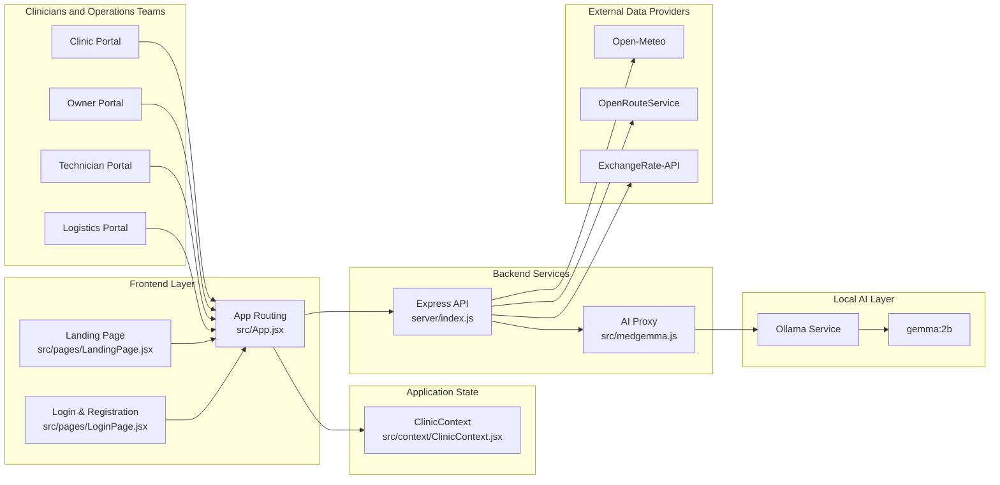
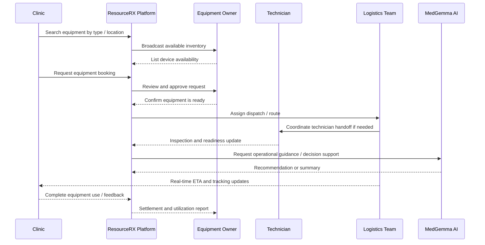
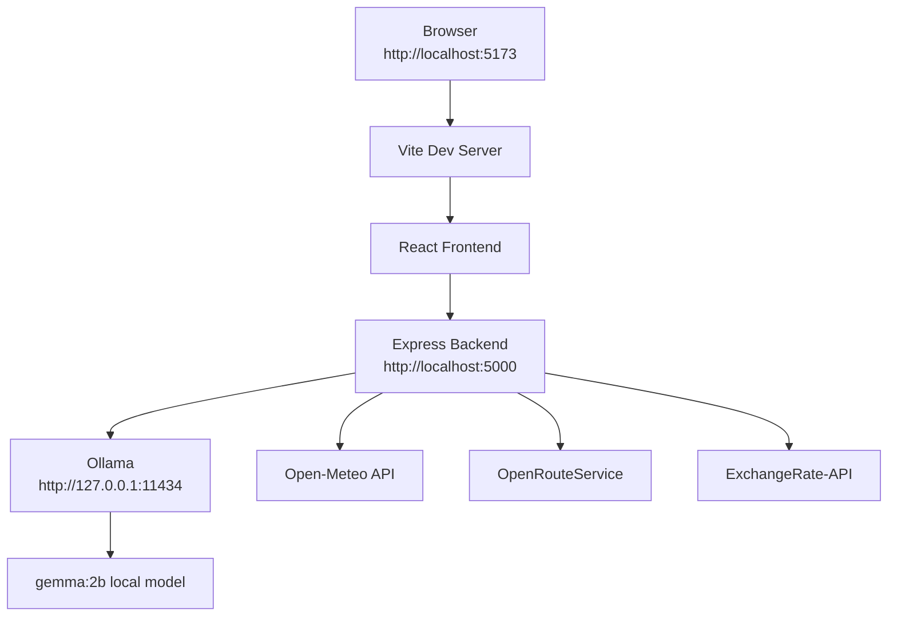

# ResourceRX

AI-powered peer-to-peer medical equipment sharing network that helps hospitals and care facilities match idle, high-value equipment with urgent demand across four role-based portals.

[](https://nodejs.org/)
[](https://react.dev/)
[](https://vite.dev/)
[](https://ollama.com/)
[](LICENSE)

## What the project does

ResourceRX is a local-first equipment-sharing platform built for healthcare operations. It gives clinics, owners, technicians, and logistics teams a single system for locating medical devices, booking transfers, tracking status, coordinating service, and monitoring utilization.

The platform is designed around equipment shortages and urgent care needs. A facility with idle MRI, CT, ventilator, or dialysis equipment can make that capacity visible to another facility that needs it immediately. Each role has a dedicated portal for the tasks they need to perform.

## Why the project is useful

Healthcare operations rely on equipment availability, maintenance readiness, and rapid logistics. ResourceRX helps teams do all three in one application.

### Benefits

- Faster access to critical equipment during shortages
- Better utilization of expensive machines already in the network
- Clear role-based experiences for clinics, owners, technicians, and logistics teams
- Real-time equipment movement and ETA visibility
- AI-assisted recommendations and operational support without cloud dependence
- Privacy-friendly, local-first architecture suitable for internal deployment

## High-level system overview



## Role-based architecture

```mermaid
flowchart TB
    subgraph Clinic[Clinic Portal]
        Search[Search Equipment]
        Booking[Book Asset]
        Track[Track Delivery]
        Pay[Payments]
        Review[Completion & Feedback]
    end

    subgraph Owner[Owner Portal]
        Add[Add Inventory]
        Analytics[Analytics]
        Dispatch[Dispatch]
        Settlements[Settlements]
    end

    subgraph Tech[Technician Portal]
        Service[Service Orders]
        Diagnose[Diagnostics]
        Calibrate[Calibration]
        Inventory[Inventory]
    end

    subgraph Logistics[Logistics Portal]
        Active[Active Shipments]
        Incident[Incident Handling]
        Map[Map View]
        Logs[Operational Logs]
    end

    Search --> Booking --> Track --> Pay --> Review
    Add --> Analytics --> Dispatch --> Settlements
    Service --> Diagnose --> Calibrate --> Inventory
    Active --> Incident --> Map --> Logs

    click Search "https://github.com/Jasmine0987/ResourceRX/tree/main/src/pages/Clinic"
    click Add "https://github.com/Jasmine0987/ResourceRX/tree/main/src/pages/Owner"
    click Service "https://github.com/Jasmine0987/ResourceRX/tree/main/src/pages/Technician"
    click Active "https://github.com/Jasmine0987/ResourceRX/tree/main/src/pages/Logistics"
```



## Equipment lifecycle flow



## Runtime and deployment model



## Project structure

```text
ResourceRX/
├── src/
│   ├── pages/
│   │   ├── Clinic/
│   │   ├── Logistics/
│   │   ├── Owner/
│   │   ├── Technician/
│   │   ├── LandingPage.jsx
│   │   └── LoginPage.jsx
│   ├── components/
│   │   ├── ClinicSideBar.jsx
│   │   ├── LogisticsSideBar.jsx
│   │   ├── MedGemmaChat.jsx
│   │   ├── OwnerSideBar.jsx
│   │   └── TechnicianSideBar.jsx
│   ├── context/
│   │   └── ClinicContext.jsx
│   ├── App.jsx
│   ├── App.css
│   ├── index.css
│   ├── main.jsx
│   └── medgemma.js
├── server/
│   ├── index.js
│   └── package.json
├── public/
├── index.html
├── package.json
├── vite.config.js
├── tailwind.config.js
├── postcss.config.cjs
├── eslint.config.js
├── README.md
├── .gitignore
├── pnpm-lock.yaml
├── LICENSE
└── docs/
    └── (add docs as needed)
```

## Technology stack

### Frontend

- React 19
- Vite
- React Router DOM
- Tailwind CSS
- Framer Motion
- Lucide React

### Backend

- Node.js 18+
- Express 5
- CORS support for localhost development
- Local AI proxy to Ollama

### AI and service integrations

- Ollama with `gemma:2b`
- Open-Meteo weather API
- OpenRouteService routing API
- ExchangeRate-API currency data

## Getting started

### Prerequisites

- Node.js 18 or newer
- npm
- Ollama installed locally
- Git

### 1. Install frontend dependencies

```bash
npm install
```

### 2. Install backend dependencies

```bash
cd server && npm install && cd ..
```

### 3. Install a local model with Ollama

```bash
curl -fsSL https://ollama.com/install.sh | sh
ollama pull gemma:2b
```

### 4. Run the services

Open three terminals.

#### Terminal 1: AI engine

```bash
ollama serve
```

#### Terminal 2: backend

```bash
cd server
node index.js
```

#### Terminal 3: frontend

```bash
npm run dev
```

Open the app at:

- Frontend: http://localhost:5173
- Backend: http://localhost:5000

### Verify AI connectivity

```bash
curl http://localhost:5000/test-ai
```

Expected output indicates that the local Ollama model is responding.

## Main API routes

The backend in `server/index.js` exposes a combination of local and live-data endpoints:

| Method | Route | Purpose |
|---|---|---|
| GET | `/` | Backend health check |
| POST | `/api/medgemma` | Send prompt to Ollama |
| GET | `/test-ai` | Verify the AI service |
| GET | `/api/positions` | Real-time device positions |
| GET | `/api/equipment` | Equipment catalog and availability |
| GET | `/api/weather` | Weather for route and ETA forecasting |
| GET | `/api/route` | Travel distance and route approximation |
| GET | `/api/currency` | Exchange rate data |

## Developer notes

Some of the app’s behavior is intentionally powered by local and fallback data so the project can run without external credentials during development.

Examples from the backend:

- `server/index.js` uses local in-memory position tracking for equipment movement
- weather, route, and currency data fall back gracefully if external APIs are unavailable
- AI calls are routed to a local Ollama engine instead of a cloud-hosted model

This keeps the project easy to demo locally while still simulating operational conditions.

## How users can get help

Use the repository’s GitHub support surfaces for help:

- Open a GitHub issue for bugs or feature requests
- Ask questions in the repository discussions if enabled
- Review implementation details in `src/`, `src/pages/`, and `server/index.js`

## Who maintains and contributes

This project is maintained by the repository owner and community contributors. Contributions are welcome via pull requests.

### Suggested contribution workflow

1. Fork the repository
2. Create a feature branch
3. Make focused changes
4. Validate with local development steps
5. Open a pull request with a clear summary and screenshots when relevant

## Contributing

- Prefer small, reviewable changes
- Keep components and routes scoped to clear user roles
- Follow existing JavaScript patterns and project conventions
- Run linting and validate locally before submitting pull requests

## Documentation references

- [README](README.md)
- [src/App.jsx](src/App.jsx)
- [src/pages/LandingPage.jsx](src/pages/LandingPage.jsx)
- [server/index.js](server/index.js)
- [src/components/MedGemmaChat.jsx](src/components/MedGemmaChat.jsx)

## Support

This project is a demo and operational prototype. If used for real healthcare deployment, validate all workflows with local clinical, compliance, and operational review before production use.

## License

This repository is intended to be open source, but a formal license file should be confirmed before broader redistribution or commercial reuse.
